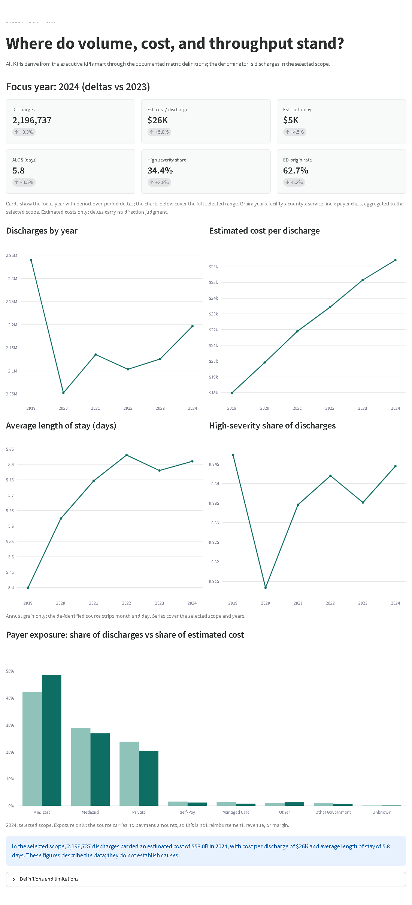
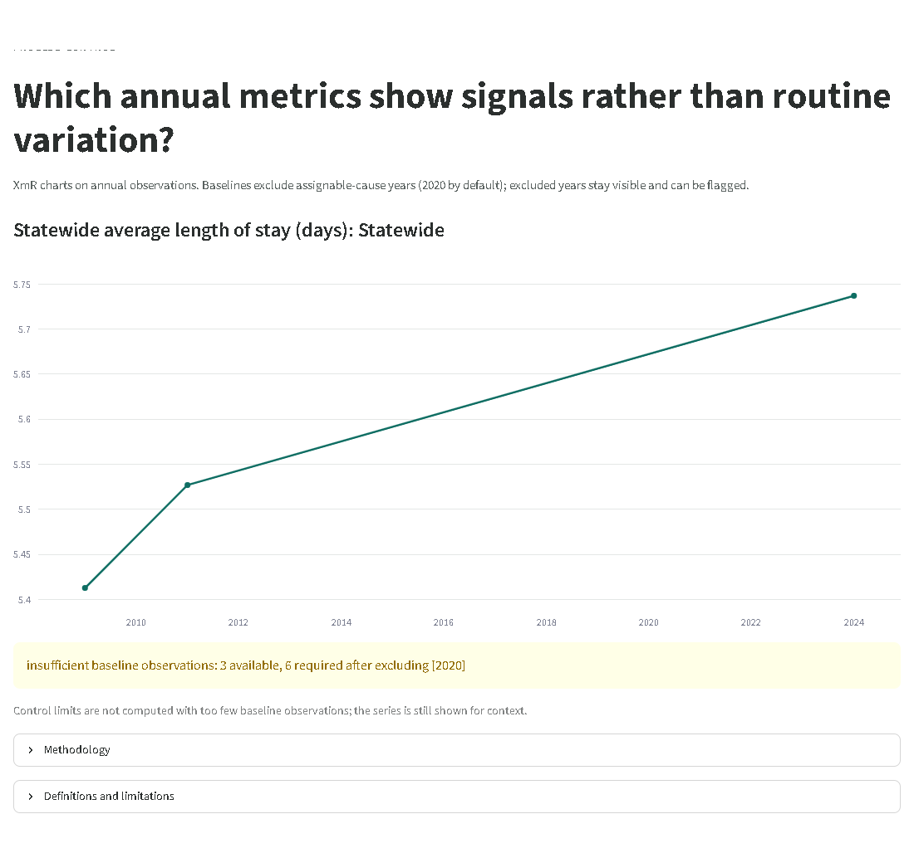
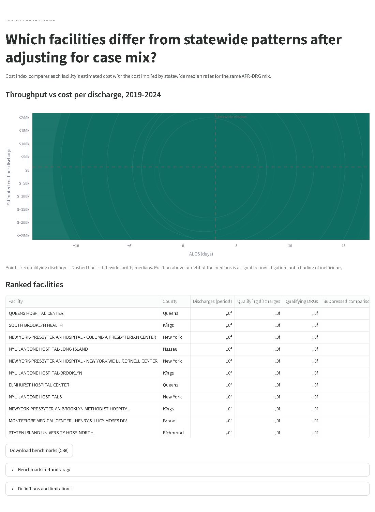
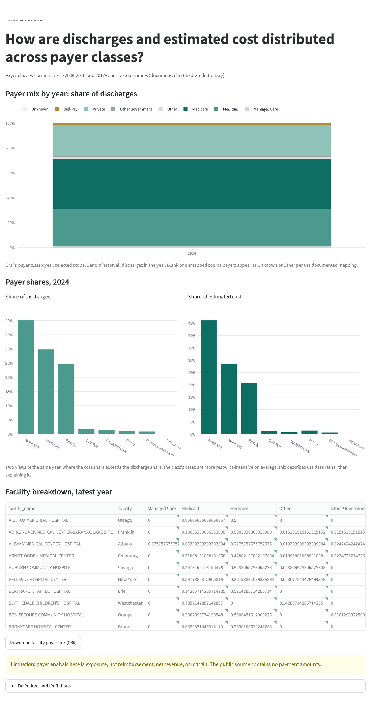
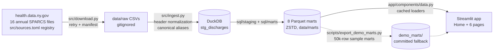

# NY SPARCS Healthcare Operations BI

An in-house healthcare operations BI system built on New York State's public
SPARCS inpatient discharge data: Python, DuckDB, SQL transformations, Parquet
marts, and a Streamlit front end. Version-controlled analytics a hospital
system owns end to end, instead of a per-seat BI tool dependency.

## Business problem

New York hospital systems operate on thin margins driven by payer mix, case
complexity, and length of stay. A regional system's finance and operations
committee needs one view of where cost and throughput concentrate by facility,
service line, and payer, and which facilities show potential operational
outlier signals after accounting for case complexity.

**Business question.** Where are cost and throughput concentrated by facility,
service line, and payer, and which facilities have potential operational
outlier signals after accounting for case complexity?

The application answers it in six pages:

| Page | Business question |
|---|---|
| Executive Summary | Where do volume, cost, and throughput stand for the selected scope, and how do they compare with the prior year? |
| Service Lines | Which service lines and APR-DRGs concentrate estimated cost, and which are moving? |
| Payer Exposure | How are discharges and estimated cost distributed across payer classes, and how concentrated is that exposure? |
| Facility Benchmarks | Which facilities differ from patterns in the selected data after adjusting for case mix, and by how much? |
| Process Control | Which annual metrics show signals for investigation rather than routine variation? |
| Data Quality | What is in the data, what is missing, and what should not be compared across years? |

## Screenshots

| | |
|---|---|
|  |  |
|  |  |

Captured from a full 2009-2024 build. A clone without local marts renders
the same views from the committed demo marts (50k-row samples).

## Data source

[Hospital Inpatient Discharges (SPARCS De-Identified)](https://health.data.ny.gov/stories/s/SPARCS-PUF-Story-Page/wvua-rr23/)
public use files published by the New York State Department of Health, annual
releases 2009 through 2024 (~2.2M discharges per year). De-identified public
data only; nothing here attempts re-identification.

Facts that shape every interpretation, enforced in code and captions:

- Time grain is annual; the source strips discharge day and month.
- Estimated costs are DOH-derived estimates; charges are not reimbursement.
- No payment or revenue amounts exist in the source, so payer analysis is
  exposure analysis, not margin analysis.
- APR-DRG is the stable clinical key across years; CCS (pre-2018) and CCSR
  (2018+) categories are never compared across that boundary.
- Abortion-related discharges have facility fields redacted at source; they
  count in dataset totals and never in facility comparisons.

See [docs/limitations.md](docs/limitations.md) before quoting any figure.

## Architecture



| Path | Responsibility |
|---|---|
| `src/` | Download, ingest, transform, metrics, quality, control charts |
| `sql/` | Staging and mart SQL, reviewed as SQL not string literals |
| `data/` | `raw/` and `processed/` gitignored; `marts/` is the local build output |
| `demo_marts/` | Committed sample-built marts; served when `data/marts/` is absent |
| `app/` | Streamlit pages and shared components (theme, filters, charts) |
| `scripts/` | Pipeline runner, mart validation, demo-mart export, screenshots |
| `tests/` | pytest suite; synthetic fixtures only, never SPARCS extracts |
| `docs/` | Architecture, data dictionary, metric definitions, limitations, SPC methodology |

## Metrics

Every KPI has one written definition, one implementation, and tests on hand
calculated values. Full detail in
[docs/metric_definitions.md](docs/metric_definitions.md).

| Metric | Definition |
|---|---|
| Discharges | Count of discharge records after staging inclusion rules |
| Cost per discharge | Sum of estimated costs / discharges |
| Cost per day | Sum of estimated costs / sum of LOS; zero or missing LOS excluded, never divide by zero |
| ALOS | Mean length of stay at the selected grain |
| High-severity share | Discharges with APR severity of illness 3 or 4 / all discharges |
| ED-origin rate | Admissions originating in an emergency department / all admissions |
| Post-acute discharge rate | Discharges to SNF, rehab, or other documented non-home destinations / all discharges |
| Payer exposure | Share of discharges and of estimated cost by payer class; labeled exposure, never revenue or margin |
| Facility cost index | Case-mix adjusted index, below |

**Facility cost index** (indirect standardization): per facility and APR-DRG,
cost per discharge = estimated cost / discharges; the benchmark for
a DRG is the median of facility-level cost per discharge among qualifying
facilities; expected benchmark cost = sum over qualifying DRGs of discharges x
that DRG's median; index = total estimated cost / expected benchmark cost.
The facility's own discharge mix self-weights the rollup, so no arbitrary
weighting is introduced. Comparisons below 30 facility-DRG discharges in the
period are suppressed and counted, not silently dropped; facilities below 100
total discharges get no index and a low-volume caution. An index above 1.0 is
a signal for investigation, not a finding of inefficiency.

**Process control** uses XmR charts on annual series: centerline = mean of
baseline years (2020 excluded by default as an assignable-cause period, still
displayed and shaded), sigma = mean moving range / 1.128, limits at
centerline ± 3 sigma. Limits are the voice of the process, never targets.
Two rules: a point beyond a 3-sigma limit, and a run of 8 consecutive points
on one side of the centerline. Flags read as potential special-cause
variation, a signal for investigation. Method detail in
[docs/spc_methodology.md](docs/spc_methodology.md).

## Running locally

Requires Python 3.11 or 3.12.

```bash
python -m venv .venv
.venv\Scripts\activate            # Windows
source .venv/bin/activate         # macOS / Linux
pip install -r requirements.txt
```

The app runs immediately on the committed demo marts:

```bash
streamlit run app/Home.py
```

To build real marts, download data first. Samples (~20 MB each) exercise the
full pipeline including schema drift:

```bash
python -m src.download --sample 50000 --years 2009 2011 2024
```

Full extracts (~10 GB total) build production marts:

```bash
python -m src.download --years 2009 2010 2011 2012 2013 2014 2015 2016 \
                          2017 2018 2019 2020 2021 2022 2023 2024
python scripts/run_pipeline.py
python scripts/validate_marts.py
```

Locally built marts always take precedence over the demo marts. Optional:
keep large raw files outside the repository by pointing `SPARCS_BI_DATA_ROOT`
at another directory; marts always stay inside the repository.

## Deployment (Streamlit Community Cloud)

The repository is deploy-ready as is: the app falls back to `demo_marts/` when
no local build exists, requirements are pinned, and no secrets are needed.

1. Push this repository to GitHub.
1. At [share.streamlit.io](https://share.streamlit.io), connect the GitHub
   account, and create an app from this repository.
1. Main file path: `app/Home.py`. Select Python **3.11** in Advanced settings,
   matching the CI environment. The project supports Python 3.11 and 3.12.
1. No secrets or custom build commands are required.

The default hosted demo serves the committed marts (under 0.5 MB), built
from **50,000 public records each for 2009, 2011, and 2024**. Every page
discloses sample fallback and labels sample-wide comparisons accordingly.
Sample aggregates are not statewide totals or hospital performance findings.
Three sample years cannot support the six-point control-chart baseline;
the app shows the available series and explains the missing limits.

Locally built `data/marts/` files take precedence one mart at a time.
Local file presence does not establish full statewide coverage: local marts
can also come from sample downloads. Local views use neutral dataset labels.
Data Quality reads run metadata beside its displayed mart and reports when
that associated metadata is missing; it does not borrow another build's metadata.
`SPARCS_BI_DATA_ROOT` changes raw and working-data paths, not the mart path.
Hosting full extracts and marts requires separate resource sizing; this
sample deployment does not require those downloads.

## Testing and CI

```bash
ruff check .
ruff format --check .
pytest -q
```

CI runs the same gates on every push and pull request. Tests cover ingest
header normalization across the real schema variants, mart reconciliation,
hand-calculated KPI and cost-index values, control-chart rules with fixtures
whose limits are computed by hand, page rendering, KPI-to-mart
reconciliation, and empty-state behavior. Synthetic fixtures only: no SPARCS
extract is ever committed or fetched by a test.

## Documentation

| Document | Contents |
|---|---|
| [docs/architecture.md](docs/architecture.md) | Layer design, mart grains, milestone status |
| [docs/data_dictionary.md](docs/data_dictionary.md) | Source registry and verified value domains |
| [docs/metric_definitions.md](docs/metric_definitions.md) | Precise KPI definitions and units |
| [docs/spc_methodology.md](docs/spc_methodology.md) | XmR construction, rules, exclusion policy |
| [docs/schema_drift.md](docs/schema_drift.md) | Year-by-year schema changes and handling |
| [docs/limitations.md](docs/limitations.md) | Known limitations and interpretation caveats |

## License

[MIT](LICENSE)
