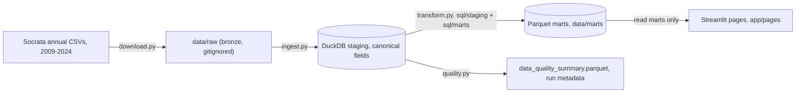

# Architecture

Planned pipeline, implemented progressively under milestone-gated delivery.
Status per layer is tracked at the bottom of this document.

## Marts

Page-oriented Parquet marts, each with a single documented grain. Measures
are additive so every KPI derives correctly at any filter scope. Zero
denominators yield NULL, never errors. Metric semantics live in
`src/metrics.py`; SQL implements the same formulas.

| Mart | Grain | Key measures |
|---|---|---|
| `executive_kpis.parquet` | year x facility x county x service line (APR-MDC) x payer class | discharges, estimated cost, charges, bed days, severity/ED/post-acute counts |
| `executive_trends.parquet` | year (statewide) | the six executive KPIs plus derived rates |
| `payer_exposure.parquet` | year x facility x county x payer class | discharges, estimated cost (exposure, not margin) |
| `service_line_summary.parquet` | year x service line (APR-MDC) x APR-DRG | volume, estimated cost, ALOS, high-severity counts |
| `facility_benchmarks.parquet` | year x facility (redacted excluded) | volume, cost per discharge, ALOS, severity share |
| `facility_drg_benchmarks.parquet` | year x facility x APR-DRG (redacted excluded) | volume, estimated cost, bed days, severity counts feeding the case-mix adjusted cost index |
| `process_control_series.parquet` | metric x series x year | numerator, denominator, value (statewide 5 metrics + per-MDC ALOS and cost) |
| `data_quality_summary.parquet` | year | completeness, invalid-value counts, redaction share, schema family |

Run metadata (`run_metadata.json`) records the build time, source files,
per-year staging counts, mart row counts, and payer values that fell to
`Other`, so nothing is silently reclassified.

## Pipeline

## Layers and responsibilities

| Layer | Location | Responsibility |
|---|---|---|
| Acquisition | `src/download.py` | Retry-safe annual CSV download from the committed registry (`src/sources.toml`) |
| Inspection | `scripts/inspect_sources.py` | Regenerate the registry and schema-drift report from live Socrata catalogs |
| Staging | `src/ingest.py`, `sql/staging/` | Raw to typed DuckDB tables, canonical field mapping across schema drift |
| Marts | `src/transform.py`, `sql/marts/` | Page-oriented Parquet marts, each with documented grain |
| Metrics | `src/metrics.py` | Single source of truth for KPI calculations |
| Process control | `src/control_charts.py` | XmR calculations and special-cause rules, 2020 baseline exclusion |
| Quality | `src/quality.py` | Completeness, invalid-value, schema-drift, run metadata |
| Presentation | `app/` | Streamlit pages; reads marts only, never raw CSVs |

## Design rules

- The app never queries raw CSVs during page loads; it reads Parquet marts.
- All paths derive from `src/config.py` (`PROJECT_ROOT`), no hardcoded local
  absolute paths.
- Business transformations live in SQL files under `sql/`, not inline Python.
- Tests run against synthetic fixtures that represent schema variation, never
  against SPARCS extracts.
- `demo_marts/` carries committed marts built from 50k-row samples; the app
  serves them only when locally built marts in `data/marts/` are absent, so a
  clone or hosted deployment renders without the ~10 GB download.

## Milestone status

| Milestone | Scope | Status |
|---|---|---|
| 0 | Foundation: structure, tooling, CI | Complete |
| 1 | Source registry, download, ingestion, canonical mapping | Complete |
| 2 | Staging model, marts, metrics, quality output | Complete |
| 3 | Benchmarks and XmR control charts | Complete |
| 4 | Streamlit application | Complete |
| 5 | Documentation, deployment, final audit | Complete |
