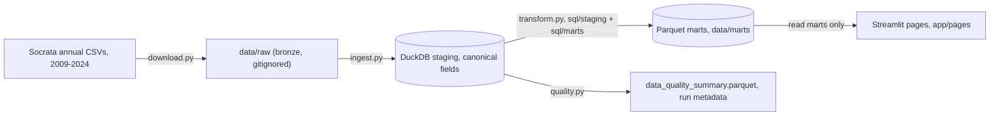

# Architecture

Planned pipeline, implemented progressively under milestone-gated delivery.
Status per layer is tracked at the bottom of this document.

## Pipeline

## Layers and responsibilities

| Layer | Location | Responsibility |
|---|---|---|
| Acquisition | `src/download.py` | Retry-safe annual CSV download from a documented source registry |
| Staging | `src/ingest.py`, `sql/staging/` | Raw to typed DuckDB tables, canonical field mapping across schema drift |
| Marts | `src/transform.py`, `sql/marts/` | Page-oriented Parquet marts, each with documented grain |
| Metrics | `src/metrics.py` | Single source of truth for KPI calculations |
| Process control | `src/control_charts.py` | XmR calculations and special-cause rules, 2020 baseline exclusion |
| Quality | `src/quality.py` | Completeness, invalid-value, schema-drift, run metadata |
| Presentation | `app/` | Streamlit pages; reads marts only, never raw CSVs |

## Design rules

- The app never queries raw CSVs during page loads; it reads Parquet marts.
- All paths derive from `src/config.py` (`PROJECT_ROOT`), no hardcoded local
  absolute paths.
- Business transformations live in SQL files under `sql/`, not inline Python.
- Tests run against synthetic fixtures that represent schema variation, never
  against SPARCS extracts.

## Milestone status

| Milestone | Scope | Status |
|---|---|---|
| 0 | Foundation: structure, tooling, CI | Complete |
| 1 | Source registry, download, ingestion, canonical mapping | Not started |
| 2 | Staging model, marts, metrics, quality output | Not started |
| 3 | Benchmarks and XmR control charts | Not started |
| 4 | Streamlit application | Not started |
| 5 | Documentation, deployment, final audit | Not started |
